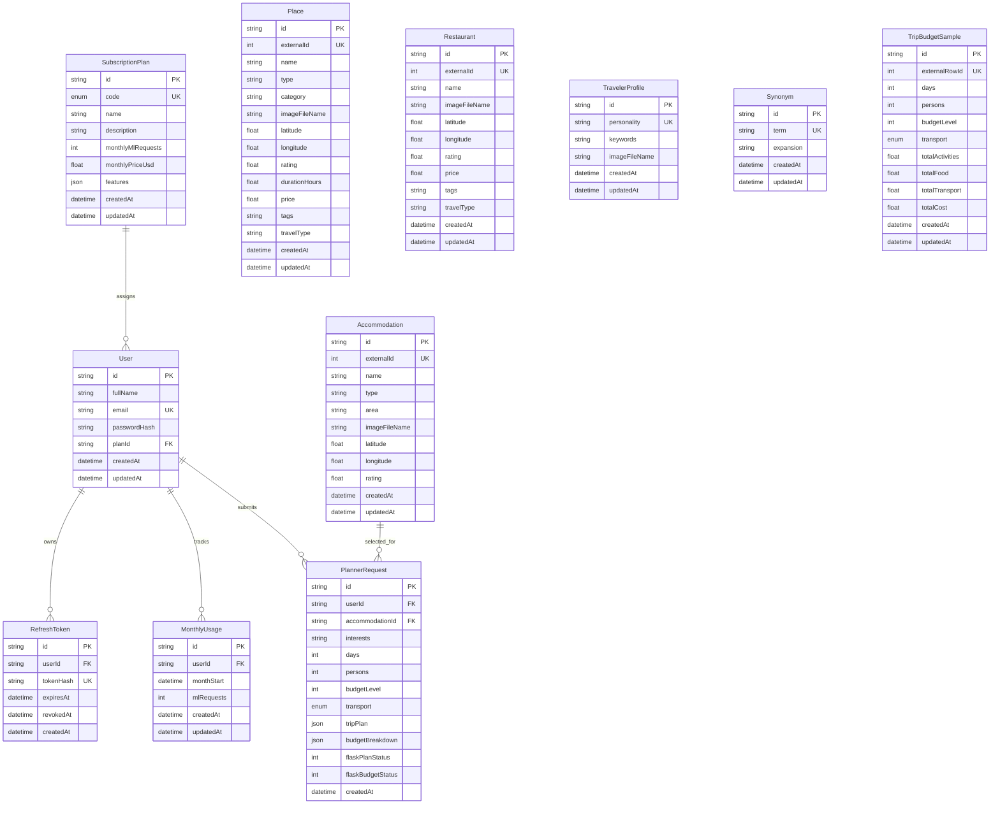

# DjerbaStay Prisma ERD

This ERD reflects the schema defined in `DjerbaStay-Backend/prisma/schema.prisma`.

## Notes

- `FREE`, `PLUS`, and `PREMIUM` are stored in `SubscriptionPlan.code`.
- Monthly AI usage limits are enforced from `SubscriptionPlan.monthlyMlRequests`.
- Planner outputs from Flask (`tripPlan` and `budgetBreakdown`) are persisted in `PlannerRequest`.
- All AI CSV data from `DjerbaStay-Ai/data` is imported via `DjerbaStay-Backend/prisma/seed.ts`.
